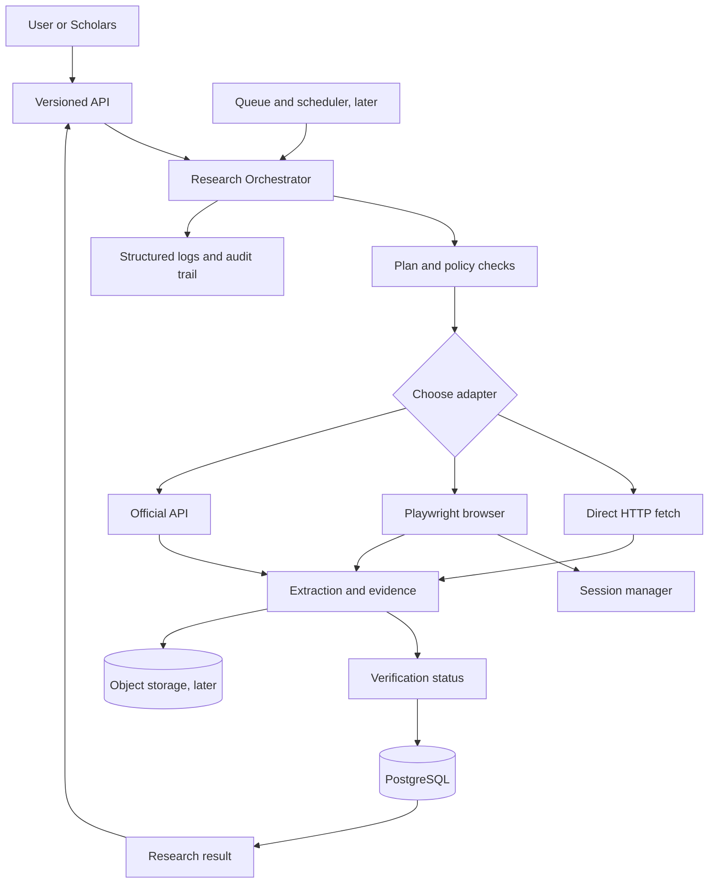

# Serena: Initial Architecture and Engineering Roadmap

**Status:** Architecture baseline, not an implementation

**Prepared:** 11 October 2026

**Purpose:** Define a small, secure starting point for a unified personal research and browser-agent platform that can later support memory, authenticated sessions, crawling, evidence-backed reports, scheduling, and API integration with Scholars.

## 1. Objective and executive overview

Serena should become one reusable intelligence layer rather than a collection of unrelated scripts. A user submits a research objective. Serena creates a controlled plan, chooses among direct HTTP fetching, browser automation, official APIs, and later authenticated sessions, records what it did, extracts findings with evidence, and returns a report that distinguishes verified information from uncertainty.

The most important architectural decision is to **start as a modular monolith**. All initial modules live in one TypeScript repository and one deployable application, but their responsibilities are separated behind interfaces. This keeps development manageable through direct GitHub commits and cloud deployment without introducing microservices, Kubernetes, or a distributed agent framework before there is a real need.

The first useful version should not try to automate every website or solve every authentication challenge. It should demonstrate a trustworthy research loop on public websites:

1. Accept one research request.
2. Visit a small, explicitly allowed set of public URLs.
3. Extract page titles and selected text.
4. Save sources, timestamps, and evidence snippets.
5. Return a structured result and a trace of actions.

Authenticated browser profiles, crawling, AI planning, memory, scheduling, and the public API should be added in that order only after this deterministic foundation works.

## 2. Scope decisions

### Build first

- TypeScript and Node.js project foundation.
- A deterministic browser adapter using Playwright.
- One safe research operation: navigate to an allowed URL and extract structured page data.
- A source/evidence data model, initially in memory or a local JSON fixture.
- Tests against stable local HTML fixtures and a small number of public pages.
- Structured logs with task ID, URL, action, duration, outcome, and error class.

### Deliberately postpone

- Fully autonomous open-ended planning.
- Multi-agent orchestration.
- Vector databases and semantic memory search.
- Password storage and unattended login.
- CAPTCHA or access-control circumvention.
- Broad-domain crawling.
- Browser fingerprint evasion or stealth tooling.
- Financial, legal, medical, account-changing, purchasing, or application-submission actions.
- A separate frontend, worker service, and queue service before the core loop is proven.

These exclusions are not permanent product limitations. They are safety and cost boundaries for the first milestone.

## 3. Proposed architecture

### Component responsibilities

- **API/application layer:** accepts research requests, validates inputs, returns task status and results.
- **Orchestrator:** coordinates a task lifecycle and enforces timeouts, action budgets, allowed domains, and cancellation.
- **Research adapters:** direct HTTP fetcher, Playwright browser adapter, official-API adapters, and later Crawlee.
- **Extraction and evidence layer:** turns retrieved content into structured records and preserves source URL, retrieval time, excerpt, and verification state.
- **Persistence layer:** PostgreSQL metadata and object storage for larger documents, screenshots, or encrypted session artifacts.
- **Session manager:** later owns account-specific browser contexts and encrypted authentication state. It must never expose raw passwords to ordinary research code.
- **Worker/scheduler layer:** later runs long tasks outside an HTTP request and starts monitoring jobs.
- **Integration layer:** versioned API for Scholars and future applications.
- **Observability layer:** structured logs, action traces, failures, metrics, and audit records.

### Information flow



### Text-only version

```text
Client (mobile dashboard or Scholars)
        |
        v
Versioned API -> Research Orchestrator -> Policy and budget checks
                                      |
                    +-----------------+------------------+
                    |                 |                  |
               HTTP fetch       Playwright          Official API
                    |                 |                  |
                    +-----------------+------------------+
                                      v
                         Extraction -> Evidence -> Verification
                                      |
                            PostgreSQL + object storage
                                      |
                         Result, trace, logs, audit record
```

The browser is an execution tool, not the source of truth. A conclusion is only as strong as its stored evidence and verification status.

## 4. Technology decisions

### Recommended initial stack

- **Runtime:** Node.js LTS with TypeScript and native ECMAScript modules.
- **Backend:** Fastify for a small typed HTTP API. Its plugin model is enough for the first application without bringing in a large framework. Official TypeScript guidance is available at <https://fastify.dev/docs/latest/Reference/TypeScript/>.
- **Browser automation:** Playwright. It supports Chromium, Firefox, and WebKit and provides isolated browser contexts. Playwright's authentication guidance explicitly warns that stored browser state can contain cookies and headers capable of impersonation, so auth artifacts must be ignored by Git and encrypted in production [1].
- **HTTP retrieval:** native `fetch` first. Add a dedicated HTTP client only when retry, decompression, proxy, or timeout requirements justify it.
- **Crawling:** do not add Crawlee in the first milestone. Add it during the controlled-crawling phase. Crawlee provides `CheerioCrawler` for HTTP pages and `PlaywrightCrawler` for JavaScript-rendered pages, with shared interfaces and request queues [2].
- **Database:** PostgreSQL, preferably Supabase initially. Supabase can be used as ordinary Postgres from a backend, and its documentation describes direct and pooled connection modes [3].
- **ORM/query layer:** Drizzle or Prisma can both work. Use Drizzle if the priority is thin SQL-like control and low abstraction; use Prisma if beginner ergonomics and generated types matter more. For the first milestone, postpone an ORM and use a small repository interface plus migrations once the first data model is stable.
- **Validation:** Zod or Fastify JSON Schema. Use one schema system consistently. Zod is beginner-friendly; Fastify JSON Schema integrates directly with route validation and serialization.
- **Tests:** Vitest for unit tests and Playwright Test for browser-level tests. Keep network-dependent tests separate from deterministic fixture tests.
- **Formatting and quality:** ESLint, Prettier, strict TypeScript, and GitHub Actions for CI.
- **Deployment:** GitHub as the source of truth. Changes are made and verified in the managed development environment, pushed directly to GitHub, and deployed through cloud infrastructure. No local computer or notebook runtime is required.

### Essential versus optional

**Essential for the MVP:** TypeScript, Node.js, Playwright, Fastify or an equivalent small HTTP layer, schema validation, tests, GitHub, and a simple persistence boundary.

**Useful later:** Crawlee, PostgreSQL/Supabase, a managed browser such as Browserbase, object storage, a queue, a scheduler, and an LLM with tool calling and structured output.

**Not justified initially:** LangChain-style agent frameworks, multi-agent systems, vector databases, Kubernetes, browser stealth products, or a separate microservice for every adapter.

### Why not begin with an AI agent loop?

A deterministic browser operation provides a baseline against which later planning can be evaluated. If an AI planner is introduced first, a failure could come from navigation, selectors, policy, extraction, model reasoning, or storage, and the project would be difficult to debug. The first planner should call the same typed tools as a human-written workflow.

## 5. Hosting and cost strategy

### Prototype configuration: target $0 to low single digits per month

- Development and deterministic tests: the managed development environment, GitHub Actions, and cloud previews.
- Database: Supabase Free, subject to current limits. The current pricing page lists Free at $0, 500 MB database size, 1 GB file storage, 5 GB egress, and a limit of two active projects; it also states that free projects pause after one week of inactivity [4].
- Scheduling for experiments: manual runs or GitHub Actions. GitHub scheduled workflows use UTC by default, have a five-minute minimum interval, can be delayed under load, and in public repositories can be disabled after 60 days of inactivity [5]. They are suitable for lightweight prototypes, not for a dependable browser worker.
- Browser execution: a pinned Playwright container or managed browser service from the beginning; no production browser process depends on a temporary notebook session.

### Small production configuration: likely tens of dollars per month, depending on usage

- One always-available API service.
- One separately controlled worker for browser jobs.
- Supabase Pro only when inactivity pausing, larger limits, backups, or support justify it. The current Supabase pricing page lists Pro from $25/month and separately describes compute credits and usage quotas [4].
- Browserbase or Browserless only when managed execution, session debugging, or persistent cloud browser behavior is required. Browserbase's official quickstart shows Playwright connecting over CDP to a managed session and provides session replay/debugging [6].
- A queue or Redis only once jobs are long-running or concurrent enough to require it.

Do not treat any free tier as a permanent guarantee. Pricing and quotas change. Record the date and URL whenever a deployment decision is made.

### Deployment recommendation

Use a **two-stage deployment**:

1. **Stage A:** run the browser adapter in a cloud container that includes Playwright browsers and dependencies. Pin the Playwright package and container version. The official Playwright Docker guidance recommends matching versions, using `--init`, and considering `--ipc=host`; it also recommends a non-root user and seccomp profile when crawling untrusted sites [7].
2. **Stage B:** move browser execution to a managed browser service when persistent sessions, interactive human assistance, parallelism, or operational debugging make self-hosting costly.

Render is a practical candidate for a small API and worker because it supports Git-connected services and cron jobs. Its cron documentation states that cron jobs cannot access persistent disks, runs are billed by active time, there is a $1 monthly minimum per cron service, and an active run is limited to 12 hours [8]. That makes Render cron useful for short scheduled jobs, but not the right place to pretend a cron process is a permanent queue worker.

## 6. Security baseline

1. Treat every webpage, document, downloaded file, and model-produced string as untrusted input.
2. Use an allowlist for domains and protocols. Start with `https` only. Block localhost, private IP ranges, cloud metadata addresses, unusual ports, file URLs, and redirects into blocked networks to reduce SSRF risk.
3. Set per-task budgets: maximum pages, total bytes, browser minutes, redirects, downloads, and model calls.
4. Do not store raw passwords in the database, source code, environment files, logs, screenshots, or prompts.
5. Keep Playwright auth state out of Git. In production, encrypt it with a managed secret or KMS-backed key and associate it with one user, website, and account.
6. Use a separate browser context per account. Never reuse one account's storage state for another account.
7. Treat successful authentication as permission to access the account, not permission to automate every action. Follow the website's terms and the account owner's authorization.
8. For OTP, CAPTCHA, passkeys, or unusual login checks, pause and request human assistance. Do not bypass or solve security challenges by evasion.
9. Require explicit approval before consequential actions such as purchases, account changes, official submissions, financial actions, or sending messages to third parties.
10. Keep an audit record of policy decisions, URLs, actions, tool outputs, approvals, and failures. Redact cookies, authorization headers, passwords, and private document contents.

## 7. Data model

The first persistent schema can be small, but it should leave room for the unified platform.

```text
users
  id, external_subject, created_at

research_tasks
  id, user_id, request_text, status, policy_snapshot, created_at, started_at, finished_at

research_plans
  id, task_id, plan_version, steps_json, created_at

sources
  id, task_id, url, canonical_url, domain, retrieved_at, http_status, content_hash

evidence
  id, source_id, locator, excerpt, content_hash, extraction_method, confidence

findings
  id, task_id, claim, status, uncertainty, created_at

finding_evidence
  finding_id, evidence_id, relationship_type

verification_records
  id, finding_id, method, verifier, result, notes, created_at

browser_accounts
  id, user_id, provider, account_label, status, last_checked_at

browser_sessions
  id, browser_account_id, storage_reference, expires_at, last_used_at, status

execution_events
  id, task_id, sequence_number, event_type, safe_payload_json, created_at

scheduled_tasks
  id, user_id, task_template_json, cron_expression, enabled, last_run_at
```

`storage_reference` must point to encrypted secret storage, not hold cookies or tokens directly. Ordinary research records and encrypted authentication artifacts must use separate storage and access policies.

## 8. API direction

Use `/v1` from the beginning. Proposed endpoints are Serena endpoints, not claims about an existing external API.

### Submit research

```http
POST /v1/research-tasks
Authorization: Bearer <application-token>
Content-Type: application/json

{
  "request": "Find three official scholarship opportunities for Nigerian undergraduates.",
  "allowedDomains": ["example.edu", "official-scholarships.example"],
  "maxSources": 5,
  "requiresApproval": false
}
```

Response:

```json
{
  "id": "task_01J...",
  "status": "queued",
  "createdAt": "2026-10-11T18:00:00Z"
}
```

### Get progress

```http
GET /v1/research-tasks/task_01J...
Authorization: Bearer <application-token>
```

```json
{
  "id": "task_01J...",
  "status": "running",
  "progress": { "pagesVisited": 2, "sourcesSaved": 2, "currentStep": "extract" },
  "lastEventAt": "2026-10-11T18:01:12Z"
}
```

### Get results

```http
GET /v1/research-tasks/task_01J.../result
Authorization: Bearer <application-token>
```

The response should contain claims, uncertainty, evidence IDs, source URLs, retrieval timestamps, and verification status. It must not return a polished conclusion without its supporting evidence.

Later endpoints can include:

- `POST /v1/research-tasks/:id/cancel`
- `GET /v1/research-tasks/:id/events`
- `POST /v1/schedules`
- `GET /v1/browser-accounts`
- `POST /v1/browser-accounts/:id/reauthenticate`
- `DELETE /v1/browser-accounts/:id`

For Scholars integration, use a machine-to-machine token with least privilege, rate limits, request IDs, idempotency keys, and a clear versioning policy. Never expose browser cookies or storage state through the API.

## 9. Complete phased roadmap

### Phase 0 — Feasibility and architecture

**Output:** this baseline, a threat model, an MVP boundary, and one written decision record.

**Gate:** you can explain the task lifecycle, the difference between a browser context and a profile, and why evidence is stored separately from a final claim.

### Phase 1 — Repository and development foundation

Create the GitHub repository, strict TypeScript configuration, environment example, linting, formatting, test command, and CI workflow. The workflow should run type checking, linting, unit tests, and fixture browser tests.

**Test:** a clean checkout can install dependencies and run all checks without secrets.

**Gate:** CI is green on a pull request and no secret is required for deterministic tests.

### Phase 2 — Basic browser adapter

Implement `BrowserAdapter.open(url)`, `readTitle()`, `readVisibleText()`, `screenshot()`, and `close()`. Add navigation timeout, allowed-protocol checks, redirect checks, and typed errors.

Playwright browser contexts provide isolation. Do not confuse a context with a persistent profile: a context is an isolated browser environment; a persistent profile uses a user-data directory and carries more browser state. Begin with non-persistent contexts and fixtures.

**Test:** navigate to a local fixture, extract a known title and paragraph, fail safely on an invalid URL, and close the browser in a `finally` block.

**Gate:** ten repeated fixture runs produce the same structured result and no browser processes remain.

### Phase 3 — Authenticated sessions

Add one account record and a session-state abstraction. Implement a human-assisted login flow for a test account only. Store Playwright `storageState` outside the repository, encrypted in production. Detect expiry by checking a known authenticated page and classify the result as `valid`, `expired`, `blocked`, or `human_action_required`.

Playwright's documentation supports saving and restoring cookies, local storage, IndexedDB, and some passkey-related state, but warns that the resulting file is sensitive [1]. Session storage is not automatically persisted by Playwright and may require site-specific handling [1].

**Gate:** two accounts cannot see each other's state, expired state is detected, and reauthentication pauses for a human instead of bypassing MFA or CAPTCHA.

### Phase 4 — Controlled discovery and crawling

Use direct HTTP for static pages and Playwright only when JavaScript interaction is needed. Add Crawlee for request queues, deduplication, retry policy, maximum request count, per-domain restrictions, pagination rules, and termination conditions [2]. Respect robots guidance where applicable, site terms, rate limits, and explicit user scope.

**Gate:** a crawl of a test website cannot leave its allowed domain, cannot exceed its page budget, records duplicate suppression, and resumes from a saved queue fixture.

### Phase 5 — AI-assisted planning

Introduce an LLM behind a provider interface. The model produces a validated plan composed only of Serena's declared tools. It may request a public page fetch or browser read, but it cannot invent arbitrary executable code or silently expand the domain scope.

Use a bounded loop: plan, execute one step, validate the result, update state, continue or stop. Stop on success criteria, evidence sufficiency, budget exhaustion, repeated failure, or human approval requirement.

**Gate:** the same request produces a schema-valid plan, an invalid plan is rejected, and a prompt injection inside a webpage cannot change policy rules.

### Phase 6 — Extraction and verification

Define schemas for findings. Every finding must include a claim, evidence IDs, source URLs, retrieval time, confidence/uncertainty, and verification status. Add cross-source comparison and explicit labels such as `unverified`, `single_source`, `corroborated`, and `contradicted`.

**Gate:** a result without evidence cannot be marked verified.

### Phase 7 — Unified research orchestration

Connect the API, planner, adapters, extraction, evidence, and persistence into one task lifecycle. Add cancellation, retries, timeouts, progress events, and resumable task state.

**Gate:** a task can be submitted, observed, cancelled, resumed where safe, and completed with a trace.

### Phase 8 — Database and storage

Move task, source, evidence, findings, and execution events into PostgreSQL. Add migrations and repository tests. Add object storage only when documents, screenshots, or exports are too large for database rows.

**Gate:** deleting a task removes or anonymizes its dependent records according to the retention policy, and secrets remain outside ordinary tables.

### Phase 9 — Workers and scheduling

Separate HTTP request handling from long-running research. Start with one worker process and a database-backed job state. Add Redis or a managed queue only when the database approach creates measurable contention. Add per-user concurrency limits and idempotency keys.

For short periodic jobs, a Render cron job or GitHub Actions schedule may be sufficient. Neither should be treated as a durable queue. Render documents a one-run guarantee and a 12-hour active-run limit [8]; GitHub documents schedule delays and public-repository inactivity behavior [5].

**Gate:** duplicate triggers do not create duplicate work, a crashed worker can recover a pending task, and concurrency is bounded.

### Phase 10 — Public backend API

Expose the versioned endpoints, authentication, rate limits, request IDs, OpenAPI documentation, and machine-to-machine access for Scholars.

**Gate:** a separate test client can submit and retrieve a task without direct database access or browser secrets.

### Phase 11 — Mobile-friendly dashboard

Build only the views needed for task creation, progress, result review, evidence inspection, connected-account status, and scheduled-task status. Keep the UI read-heavy and approval-oriented.

**Gate:** the complete flow is usable on a phone and every important claim links to evidence.

### Phase 12 — Security and reliability hardening

Add SSRF tests, secret redaction tests, authorization tests, rate-limit tests, deletion tests, browser isolation tests, audit-log review, dependency scanning, and backup/restore exercises.

**Gate:** security failures are tested as ordinary regression cases, not left as documentation only.

### Phase 13 — Memory and continuous improvement

Add explicit memory types: durable knowledge, project context, preferences, temporary notes, and unverified assumptions. Store provenance, correction history, deletion status, retention, and scope. Begin with PostgreSQL full-text or carefully designed metadata retrieval. Add embeddings only when real retrieval evaluations show they are needed.

**Gate:** a user can correct or delete a memory and future retrieval respects the correction.

## 10. Beginner-friendly learning curriculum

### Stage 1: TypeScript and HTTP basics

Learn modules, async/await, types, errors, JSON, HTTP methods, status codes, and environment variables.

Exercise: write a typed function that calls a local JSON endpoint, validates the response, and returns a discriminated success/error result.

Resources: <https://www.typescriptlang.org/docs/>, <https://nodejs.org/en/learn/getting-started/introduction-to-nodejs>, <https://developer.mozilla.org/en-US/docs/Web/HTTP/Overview>.

### Stage 2: Playwright fundamentals

Learn locators, navigation, auto-waiting, contexts, pages, downloads, timeouts, and cleanup.

Exercise: automate a local HTML fixture and save a screenshot plus extracted JSON.

Resources: <https://playwright.dev/docs/intro>, <https://playwright.dev/docs/browser-contexts>, <https://playwright.dev/docs/auth>.

### Stage 3: Backend boundaries and testing

Learn route handlers, schemas, dependency injection, unit tests, fixture tests, and integration tests.

Exercise: expose one `/health` route and one `/preview` route that returns the typed browser result.

Resources: <https://fastify.dev/docs/latest/Guides/Getting-Started/>, <https://vitest.dev/guide/>.

### Stage 4: PostgreSQL and data modeling

Learn tables, primary keys, foreign keys, indexes, transactions, migrations, and least-privilege database access.

Exercise: store one research task, one source, and one evidence excerpt, then retrieve them together.

Resources: <https://www.postgresql.org/docs/current/tutorial.html>, <https://supabase.com/docs/guides/database/connecting-to-postgres>.

### Stage 5: Agent design and evidence

Learn tool schemas, bounded loops, structured outputs, prompt injection, source attribution, and evaluation cases.

Exercise: accept a fixed research question and produce a plan that can call only `fetchPage` and `saveEvidence`.

### Stage 6: Deployment operations

Learn GitHub branches, CI, environment secrets, container images, logs, health checks, and rollback.

Exercise: deploy the deterministic `/health` service, then run a fixture test in CI.

## 11. Repository structure

```text
serena/
  apps/
    api/                    # HTTP routes and API composition
    worker/                 # Later: long-running jobs
  packages/
    core/                   # Domain types, task lifecycle, policies
    browser/                # Playwright adapter and session interfaces
    retrieval/              # HTTP and official API adapters
    extraction/             # Schemas, evidence, verification
    persistence/            # Repositories and database migrations
    observability/          # Logs, redaction, trace events
  tests/
    fixtures/               # Stable local HTML and document fixtures
    unit/
    integration/
    browser/
  docs/
    decisions/              # Architecture decision records
    threat-model.md
    roadmap.md
  infra/
    docker/
    deploy/
  .github/workflows/ci.yml
  .env.example
  package.json
  pnpm-workspace.yaml
  tsconfig.base.json
  README.md
```

For the first milestone, create only `packages/core`, `packages/browser`, `tests/fixtures`, `tests/unit`, and a minimal `apps/api` or CLI entry point. Do not create empty future services merely to make the tree look complete.

## 12. First implementation milestone: deterministic public-page reader

### Goal

Create a small TypeScript package that opens an explicitly supplied HTTPS URL or local fixture, extracts the title and visible text, and returns a typed result. It must not use an LLM, persistent login, a database, a queue, or open-ended crawling.

### Files to create

```text
package.json
pnpm-workspace.yaml
tsconfig.base.json
.env.example
.gitignore
src/core/result.ts
src/core/policy.ts
src/browser/browser-adapter.ts
src/browser/playwright-browser-adapter.ts
src/main.ts
tests/fixtures/article.html
tests/browser-adapter.test.ts
README.md
```

### Implementation sequence

1. Initialize the Git repository and package manager workspace.
2. Configure strict TypeScript and scripts for `typecheck`, `test`, `lint`, and `format:check`.
3. Add Playwright and its browser installation instructions. Pin the package version in the lockfile.
4. Implement a typed `BrowserReadResult` containing `url`, `finalUrl`, `title`, `text`, `retrievedAt`, and `durationMs`.
5. Implement URL policy checks: only `https:` and `file:` for local fixtures; reject credentials in URLs, private network targets, unsupported protocols, and URLs outside an optional allowlist.
6. Implement the adapter with a fresh non-persistent browser context per operation, a navigation timeout, a `finally` cleanup block, and typed errors.
7. Add a local HTML fixture and tests for success, invalid URL, timeout/error mapping, and cleanup.
8. Add a short README explaining how the managed development environment runs the tests and how changes are pushed to GitHub.

### Exact tests

- `reads_title_and_visible_text_from_fixture`: title and known paragraph are returned.
- `returns_final_url_after_navigation`: redirects are represented explicitly rather than silently discarded.
- `rejects_non_https_network_url`: `http`, `javascript`, `data`, and `file` network-like inputs are rejected according to the chosen policy. Local fixture access should use a controlled fixture path, not arbitrary user-supplied file URLs.
- `times_out_cleanly`: a deliberately slow fixture or mocked navigation produces a typed timeout and closes the context.
- `does_not_return_secrets_in_error_logs`: test error serialization with a URL containing a query string or authorization-like value and verify redaction.
- `repeated_runs_are_isolated`: two runs do not share cookies or local storage.

### Completion criteria

The milestone is complete only when:

- `pnpm typecheck`, `pnpm test`, `pnpm lint`, and `pnpm format:check` pass.
- The browser is always closed on success and failure.
- No authentication state is written.
- No unrestricted URL navigation is possible.
- The result includes retrieval time and final URL.
- A clean managed development checkout can reproduce the tests.
- The README explains one successful run and one expected failure.

### What success looks like

A successful result resembles:

```json
{
  "url": "https://example.org/article",
  "finalUrl": "https://example.org/article",
  "title": "Example article",
  "text": "Visible page text...",
  "retrievedAt": "2026-10-11T18:30:00.000Z",
  "durationMs": 842
}
```

This is intentionally not yet a research report. It is the reliable execution primitive that later plans, crawlers, evidence records, and AI tools will use.

## 13. Common failures and solutions

- **Playwright browser missing:** run the package's browser installation command in the same environment used for tests, and pin the browser/package compatibility.
- **Cloud development environment changes:** treat the development environment as reproducible; keep the repository, lockfile, configuration, and deployment settings in GitHub.
- **Free database pauses:** schedule an intentional health check or move to paid hosting only when the pause behavior affects a real workload.
- **Browser crashes in a container:** use a pinned Playwright image or install matching dependencies; consider `--init`, shared IPC, a non-root user, and a seccomp profile for untrusted crawling [7].
- **Website changes its selectors:** prefer accessible roles and stable semantics, isolate site-specific adapters, and record failures rather than silently returning empty data.
- **Authentication expires:** classify it and request reauthentication; do not loop indefinitely.
- **AI returns unsupported actions:** validate against a closed tool schema and reject the plan.
- **Evidence is incomplete:** mark the finding unverified or contradicted rather than filling gaps with model-generated prose.

## 14. Completion and next milestone

The architecture phase is complete when the repository and first milestone are accepted against the criteria above. The next milestone is not “build the full agent.” It is **Phase 1 plus Phase 2: create the repository foundation and complete the deterministic public-page reader**.

After that, review the actual code and test results before deciding whether to add PostgreSQL, a Fastify API, or authenticated-session support. That review is the point at which the architecture should be adjusted using evidence from the working system.

## References

[1]: https://playwright.dev/docs/auth 'Playwright Authentication'
[2]: https://crawlee.dev/js/docs/quick-start 'Crawlee Quick Start'
[3]: https://supabase.com/docs/guides/database/connecting-to-postgres 'Supabase Connect to your database'
[4]: https://supabase.com/pricing 'Supabase Pricing'
[5]: https://docs.github.com/en/actions/writing-workflows/choosing-when-your-workflow-runs/events-that-trigger-workflows 'GitHub Actions Events that trigger workflows'
[6]: https://docs.browserbase.com/welcome/quickstarts/playwright 'Browserbase Start your first session with Playwright'
[7]: https://playwright.dev/docs/docker 'Playwright Docker'
[8]: https://render.com/docs/cronjobs 'Render Cron Jobs'
